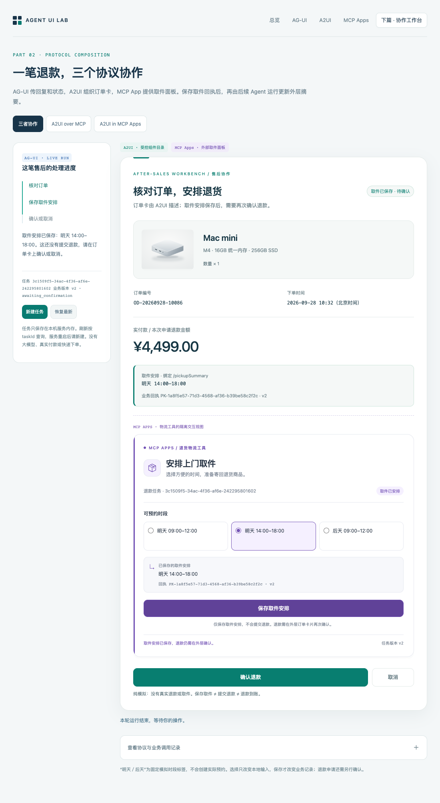

# Agent UI Lab

用同一笔模拟订单，理解 AG-UI、A2UI 与 MCP Apps 的分工与协作。包含三个独立最小示例和三种组合方式，无需模型 API Key。

## 快速开始

```sh
git clone https://github.com/pingcy/agent-ui-lab.git
cd agent-ui-lab
npm ci
npm run dev
```

打开 [三者协作工作台](http://127.0.0.1:3210/workbench)，按“选择时段 → 保存取件 → 确认退款”测试；[总览](http://127.0.0.1:3210/)保留上篇的三个独立示例。建议使用 Node.js 22 或更新版本，运行前确保本机 3210、3211 端口空闲。



## 下篇扩展：三者怎样协作（2026-10-10）

原来三个最小入口保留，新增三个可比较的入口。运行方法不变：`npm run dev`。

| 入口 | 对应文章 | 真正运行的链路 |
| --- | --- | --- |
| [三者协作工作台](http://127.0.0.1:3210/workbench) | 第 1 节与第 3 节的退款取件案例 | AG-UI 事件流 → 外层 A2UI → 内嵌 MCP App → MCP 保存 → 回执启动新一轮运行 → A2UI 数据更新 |
| [A2UI over MCP](http://127.0.0.1:3210/a2ui-over-mcp) | 第 2 节：用 MCP 传 A2UI | 真实 MCP 工具返回 `application/a2ui+json` 内嵌资源，宿主渲染，无 iframe |
| [A2UI in MCP Apps](http://127.0.0.1:3210/a2ui-in-app) | 第 2 节：渲染器放进 App | 宿主装载单文件 MCP App，App 内的 A2UI 渲染器调用工具取得界面 |

建议先打开“三者协作工作台”：

1. 初始订单 ¥4,499，取件摘要为“尚未保存”，外层“确认退款”不可点击。
2. 在紫色取件面板选择时段。此时只有 App 内本地表单改变，外层摘要不变。
3. 点击“保存取件安排”。App 获得业务回执，外层随后显示同一时段、回执与新版本，仍未提交退款。
4. 展开“协议与业务调用记录”，观察 `save_pickup`、后续 `pickup_saved` 请求，以及 `ACTIVITY_SNAPSHOT` 中的 `a2ui_operations/updateDataModel`。
5. 点击外层“确认退款”，只生成模拟退款申请；或者点击“取消”，不提交申请。**申请已提交不等于到账。**
6. 刷新当前带 `taskId` 的网址会读取同一任务，不重复保存或退款；“恢复最新”也只读服务端记录。“新建任务”才创建新任务。服务器重启后内存清空。

三个下篇入口可以用相同 `?taskId=...` 查看同一任务，验证渲染器位置不同但业务状态相同；没有 taskId 时创建独立任务。为避免旧决定接口绕过新增取件约束，下篇 store 与上篇三个入口的 store **完全隔离**。

### 和文章的实现对应

- `src/workbench.ts`：业务状态、取件回执、版本和幂等；AG-UI 事件及 A2UI 描述。
- `src/workbench-mcp.ts`：取件工具、普通 A2UI 工具和两个 App 资源。
- `src/ui/workbench.ts`：外层 `HttpAgent`、活动快照分发、正式 A2UI Action、宿主回执适配。
- `src/ui/workbench-renderer.ts`、`schemas/workbench-catalog.json`：五组件教学目录、数据绑定和 `MCPApp` 包装。后者是本例自定义组件，不是通用内置组件。
- `src/ui/workbench-bridge.ts`：真实 `AppBridge`、工具白名单、任务绑定、异源隔离视图及关闭时的迟到回执防护。
- `src/ui/pickup-app.ts`：内嵌取件 App，使用 `app.callServerTool()`。
- `src/ui/workbench-app.ts`：把同一教学渲染器打包进 App；宿主不解析 A2UI。

集成入口发往 `/api/workbench/run` 的是 POST，响应是 SSE；保存回执触发**新运行**，不是沿 SSE 反向发送，也不是恢复中断中的旧流。采用当前官方 middleware 的 `ACTIVITY_SNAPSHOT / a2ui-surface / a2ui_operations` 映射约定，但没有声称这是 AG-UI 核心自动渲染能力。

普通 A2UI over MCP 演示工具返回完整消息的 embedded resource；没有额外实现指南中的“静态模板资源 + 动态数据”拆分。两个对照入口的时段选择器是本地控件，订单摘要和最终确认卡由 A2UI 描述；只有完整协作入口采用外部取件 App。避免为了对照而递归嵌套 App。

MCP App 的保存结果先返回 App；宿主再独立提交后续运行。即使外层同步失败，也不能把已落内存的取件记录说成未保存。可点击“恢复最新”重新读取。`updateModelContext` 不参与这条路径，也不能替代业务保存或自动触发 Agent。

### 如何验证

```sh
npm run typecheck
npm test
# 服务运行后，使用已安装的 Python Playwright 与 Google Chrome：
python3 scripts/verify-workbench-browser.py
```

`npm test` 用临时本地端口进行真正 MCP HTTP/AG-UI SSE 往返，不依赖 3210 上的进程。浏览器脚本不伪造业务结果，在 375/1100px 实际操作单文件 App、双 iframe 和外层卡片。最新范围见 [下篇验证说明](VALIDATION-PART2.md) 与 [浏览器结果](workbench-browser-results.json)。

### 演示边界

所有业务为模拟数据。确定性 Agent 只分片发送预设文字，没有模型推理、真实订单、数据库、用户登录/授权、支付或物流。任务 ID 不是凭证，工具白名单和 Schema 不是生产鉴权。只绑定 `127.0.0.1`，不要对公网暴露。

`/mcp` 仍是上篇两个工具；`/mcp-workbench` 是下篇独立 MCP 服务。未在其他外部宿主中验收，也没有验证生产长任务持久化或网络中断下的旧 SSE 流重放。新增功能不修改上篇演示的业务约束。

---

固定订单 `OD-20260928-10086`：Mac mini，M4 · 16GB 统一内存 · 256GB SSD，数量 1，下单时间为 2026-09-28 10:32（北京时间），实付与全额申请金额为 ¥4,499.00。

这是确定性 Agent 桩，没有大模型、API key、订单查询或支付接口。点击“确认退款”只会**模拟提交退款申请，不代表退款到账**；点击“取消”则结束这次任务。

## 运行

需要 Node.js 20 或以上；实际回归环境为 Node.js 25.4.0。

```sh
npm ci
npm run dev
```

打开 [本地总览](http://127.0.0.1:3210/)，或直接访问：

- [AG-UI](http://127.0.0.1:3210/ag-ui)：应用自己绘制退款卡片，官方 HttpAgent 接收运行事件和任务状态；点击按钮后发起新一轮运行。
- [A2UI](http://127.0.0.1:3210/a2ui)：后端发送描述，教学渲染器绘制四种受控组件；按钮发送带 taskId 的正式 Action。
- [MCP Apps](http://127.0.0.1:3210/mcp-apps)：本地 Host 加载工具关联的 App，App 用 SDK 调用决定工具并更新自己的视图。

一个 Node 进程只绑定本机 `127.0.0.1`：主服务为 `3210`，异源 Sandbox 代理为 `3211`。两端口需空闲；也可设置不同的 `DEMO_PORT`、`DEMO_SANDBOX_PORT`。按 `Ctrl+C` 停止。

## 业务状态

```text
awaiting_confirmation
  ├─ confirm → refund_submitted（模拟申请已提交，未到账）
  └─ cancel  → cancelled（没有提交申请）
```

每次初始加载创建独立 taskId，三个页面不会自动串到同一笔任务。三条路径调用同一个内存闭包与业务函数；只有显式携带同一 taskId，才会延续同一个任务。这是应用层的适配，不代表三种协议自动互通。

相同决定幂等：重复确认返回同一申请编号，重复取消返回同一结果。终态不能换成相反决定，HTTP 适配层返回 `409`。金额使用后端订单的 `paidAmountCents: 449900`，以分存储；输入不接受客户端自定金额，返回对象的修改也不会改动服务端保存的数据。

任务保存在每个服务器实例的 Map 中，服务重启后丢失。没有数据库、用户归属校验或生产授权系统，taskId 也不是访问凭证。不要把这个本地实验部署为真实退款服务。

## 代码与协议

| 文件 | 内容 |
| --- | --- |
| `src/agent.ts` | `RefundTask`、独立内存 Store、准备与决定操作、幂等规则 |
| `src/ag-ui.ts`、`src/ui/ag-ui.ts` | 官方步骤/状态/分片文字事件与 HttpAgent |
| `src/a2ui.ts`、`src/ui/a2ui.ts` | v0.9 界面消息、正式 Action、受控教学渲染器 |
| `schemas/refund-catalog.json` | 本地四组件目录和有限外观枚举 |
| `src/mcp.ts`、`src/ui/app.ts` | 两个退款工具、单文件 HTML 资源与 App SDK |
| `src/ui/host.ts`、`src/templates.ts` | 真正 AppBridge、异源 Sandbox 代理、视图隔离 |
| `src/ui-design.ts`、`assets/mac-mini.png` | 三页的视觉规范与本地产品示意图 |
| `src/server.ts`、`test/demo.test.ts` | HTTP/SSE/MCP 适配与真实端到端回归 |

### AG-UI

运行参数的 `forwardedProps` 为 `{ intent: "prepare" }`，或 `{ taskId, decision: "confirm" | "cancel" }`。状态快照直接是 `RefundTask`，不是额外的 task 包装对象。

SSE 使用官方编码器和事件格式，包含运行、步骤、状态与多段文字事件。文字是确定性提示的分片，不是模型生成的 token。准备阶段的 `RUN_FINISHED` 表示这一轮运行结束，业务仍在等待人工确认；不让 SSE 一直挂着等待用户。

### A2UI

首次发送 `createSurface` 与 `updateComponents`，Surface 为 `refund`，Catalog 为 `https://refund-demo.local/catalog/v1`。确认与取消之后只更新组件，把按钮区替换为结果区。

`Column / Text / Image / Button` 是这个自定义目录的受控能力，不是全量基础 Catalog 实现。外观只允许 Schema 中列出的枚举，不接受任意 `style`、CSS、HTML 或函数调用。其中布局变体可映射为 flex/grid；`appearance`、按钮 `secondary`、图片 `alt` 都由本地目录明确约定，不能冒称基础 Catalog 的原生字段或值（基础 Image 的无障碍文本字段为 `description`）。

组件动作定义为 `action.event`；客户端回传则是含 `version` 的正式 Action，提供 `name`、`surfaceId`、`sourceComponentId`、`timestamp` 与 `context: { taskId }`。后端同时校验任务、来源组件和金额输入边界。传输选用 HTTP JSONL，是本实验选择，不是 A2UI 强制要求。

### MCP Apps

`review_refund` 创建待确认任务，工具元数据关联 `ui://refund/view.html`；`decide_refund` 接收 `taskId` 与 `decision`，标记为 `visibility: ["app"]`。两工具的成功 `structuredContent` 都直接返回 `RefundTask`，并保留文本结果供普通 MCP 客户端读取。

视图侧用 `App`，宿主侧用 `AppBridge`；Node 内的真实 MCP Client 转发到 `/mcp`。Web Host 与中间代理不同 origin，内部 App 在受限 iframe 中。产品图片在构建时内联为 data URI，App 无需向外部图片站请求资源。App 和 Sandbox 代理的 CSP 都需允许 `img-src data:`；srcdoc 会受父页面策略约束，不能只放宽 App 自己的策略。

`visibility` 告诉宿主工具的使用定位，不替代服务器鉴权。这个本地 Host 只开放决定工具的代理，不提供完整宿主能力或生产安全认证。

## 接入其他 MCP Apps 宿主

保持服务运行，在能访问本机的、支持 Streamable HTTP 与 MCP Apps 的宿主中配置：

```text
http://127.0.0.1:3210/mcp
```

调用 `review_refund` 后，宿主读取关联资源并把任务交给视图；不支持 Apps 的 MCP 客户端仍能读取文本结果。没有验证所有外部宿主。远端云服务的 `127.0.0.1` 指向远端自身，不能直接连接这台电脑。

## 验证

手动检查时，依次打开三个页面，核对商品图、订单号、下单时间和 ¥4,499.00；点“确认退款”，应显示申请已提交与模拟退款单号。刷新页面会创建新任务，再点“取消”，应显示取消结果且不产生退款单号。两种终态都会收起按钮，展开页面底部的日志可查看对应协议消息。

```sh
npm run typecheck
npm test
```

自动测试使用临时端口，不依赖或重启另一个已运行的服务。覆盖独立任务、幂等/冲突、金额保护、官方 SSE/Action Schema、真正 MCP HTTP 工具与资源、跨协议业务延续、图片和单文件资源。

浏览器测试是可选的，不影响应用启动。需安装 Python Playwright（`python3 -m pip install playwright`）并准备 Chrome/Chromium。脚本默认寻找 macOS 的 Google Chrome；其他系统用 `python3 scripts/verify-workbench-browser.py --browser /absolute/path/to/chrome` 指定实际浏览器路径，或设置 `DEMO_BROWSER` 环境变量。测试前先启动 demo 服务。

三路径在手机、平板与桌面宽度的确认/取消流程已通过 18 组浏览器验收，窄屏确认还验证了失败保留数据及重试。记录见 [browser-smoke-results.json](browser-smoke-results.json)，具体实测范围见 [TEST-RESULTS.md](TEST-RESULTS.md)，一手资料与协议边界见 [research-notes.md](research-notes.md)。浏览器里的“本次接收”是客户端收到结果的时间，不是退款到账时间。
